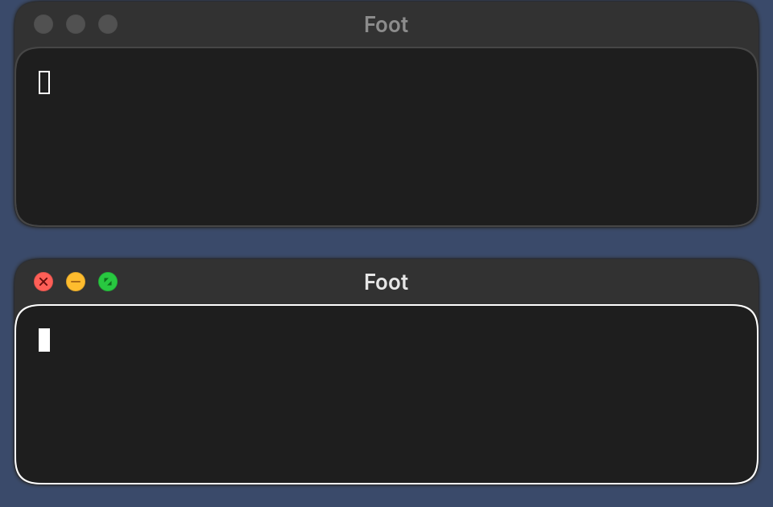
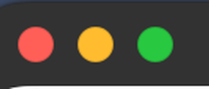
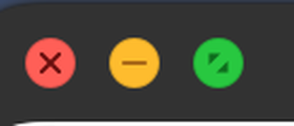

# omarchy-macos-titlebars

macOS-style title bars for [Hyprland](https://hyprland.org): traffic lights on the left, a centered title, and the small details that make them feel native.



| Resting | Hovered |
| --- | --- |
|  |  |

## What it does

- **Traffic lights drawn properly.** Each light is an anti-aliased circle with a faint rim, rendered at the exact pixel size of the monitor it is on, so it stays round and smooth at 1x, 1.5x, or 2x.
- **macOS glyphs.** Close (×), minimize (−), and full screen (two triangles) are drawn as vector shapes, not text. Hovering any light shows all three, as on macOS.
- **Unfocused windows.** Lights turn grey and the title dims.
- **Monitors with different scales.** The title keeps its size when a window moves between monitors with different scales, including mid-drag across both.
- **Titlebars stay below the top bar.** A drag stops a window's bar at the top bar, as macOS stops it at the menu bar, and a window that opens or comes back from maximized too high is moved down, so its bar can always be grabbed (`keepOnScreen.cpp`).
- **Bars stay during a swipe.** Hyprland drops the decorations of a maximized window while it slides past a workspace with a fullscreen window. The plugin turns them back on (`maximizedDecorations.cpp`).
- **Content shrinks with its window.** A floating window coming back from maximized is told its new size once the animation ends. Told at the start, a browser or Electron app redraws small at once, and its content snaps ahead of the window's box, blur and shadow (`deferShrink.cpp`).
- **Dragging out of maximized animates.** A maximized window pulled down by its titlebar shrinks to its old size under the pointer instead of jumping to it (`dragRestore.cpp`).
- **Drop-in.** The plugin registers as `hyprbars` and keeps the `hl.plugin.hyprbars` Lua interface and `plugin.hyprbars.*` options, so configs written for hyprbars or Omarchy's titlebars keep working. Square buttons (`button_rounding` ≥ 0) still draw the classic way.

It is a fork of [Omarchy's titlebars](https://github.com/omacom/omarchy-hyprland-titlebars), itself a fork of [hyprbars](https://github.com/hyprwm/hyprland-plugins/tree/main/hyprbars). Dragging, double-click to maximize, the `%WINDOW%` placeholder, app-name titles, and `workspace_tag` all come from those.

## Install

Part of [omarchy-macos](../../README.md): its `install.sh` builds this plugin for your Hyprland and loads it in place of Omarchy's titlebars. It needs no setup of its own.

Do not load it next to another `hyprbars` build; they share a name and options.

## Configure

The plugin reloads the config once it has loaded, so guard the configuration on it being there. A macOS setup:

```lua
if hl.plugin.hyprbars then
  local window = [[window = "address:%WINDOW%"]]

  hl.config({
    plugin = {
      hyprbars = {
        enabled = true,
        bar_height = 28,
        bar_color = "rgb(323232)",
        col = { text = "rgb(e6e6e6)" },
        bar_text_font = "Inter",
        bar_text_size = 13,
        bar_text_weight = "semibold",
        bar_text_align = "center",
        bar_buttons_alignment = "left",
        bar_padding = 12,
        bar_button_padding = 8,
        button_rounding = -1, -- circles: draws traffic lights
        icon_on_hover = true, -- glyphs only while a light is hovered
        inactive_button_color = "rgba(80808066)",
        inactive_title_opacity = 50,
      },
    },
  })

  for _, light in ipairs({
    { "rgb(ff5f57)", "rgba(4d0000d9)", "close", "hyprctl dispatch 'hl.dsp.window.close({ " .. window .. " })'" },
    { "rgb(febc2e)", "rgba(985712d9)", "minimize", "hyprctl dispatch 'hl.dsp.window.move({ workspace = \"special:minimized\", follow = false, " .. window .. " })'" },
    { "rgb(28c840)", "rgba(0a5d17d9)", "fullscreen", "hyprctl dispatch 'hl.dsp.window.fullscreen({ mode = \"maximized\", action = \"toggle\", " .. window .. " })'" },
  }) do
    hl.plugin.hyprbars.add_button({ bg_color = light[1], fg_color = light[2], size = 12, icon = light[3], action = light[4] })
  end
end
```

Buttons are added in order from the aligned edge, so with `bar_buttons_alignment = "left"` the first one is leftmost.

### Light glyphs

With `button_rounding = -1`, a button whose `icon` names a glyph is drawn as a traffic light with that glyph in its `fg_color`:

| `icon` | Glyph |
| --- | --- |
| `close` (or `×`, `x`) | × |
| `minimize` (or `−`, `-`) | − |
| `zoom` (or `+`) | + |
| `fullscreen` (or `maximize`, `□`, `⤢`) | two triangles |
| `""` | none, a plain light |

Any other icon is drawn as text, as in hyprbars.

### Options

All upstream [hyprbars options](https://github.com/hyprwm/hyprland-plugins/tree/main/hyprbars) apply. This fork and Omarchy's add:

| Option | Default | Behavior |
| --- | --- | --- |
| `enabled` | `false` | Upstream defaults to true. Off here, so a plugin left loaded after the config stops configuring it draws nothing. Set it to `true`. |
| `inactive_title_opacity` | `100` | Title opacity in percent while the window is unfocused. |
| `inactive_button_color` | `0` | When set, unfocused windows draw their buttons in this colour (grey lights). |
| `bar_color_inactive` | transparent | Inactive title bar colour; transparent falls back to `bar_color`. |
| `workspace_tag` | empty | When set, title bars apply only to floating windows with this tag. |
| `live_resize` | `false` | While a floating window's size animates (maximize, restore, drag out of maximized), the app is told each size along the way, so its content re-lays out with the window instead of once at the end. Light apps keep up; browsers and Electron apps step a few times and can lag a frame behind. |

`%WINDOW%` in a button `action` or `on_double_click` is replaced with the clicked window's address, so an action keeps its target even if focus changes before it runs.

## With Omarchy

Omarchy loads its own titlebar plugin for floating workspaces from a fixed path. omarchy-macos's `config/macos/titlebars.lua` wraps `hl.plugin.load` so this plugin loads instead, and if the build does not match your Hyprland, Omarchy's plugin loads, so floating windows keep their title bars. It also turns Omarchy's close, maximize and minimize buttons into the three lights.

The two plugins share the `plugin:hyprbars` options and `hl.plugin.hyprbars`. Hyprland gives each name to the plugin that registered it first and removes it when that plugin unloads. The wrapper loads this plugin while Omarchy's is still loaded, so this plugin registers the names it was refused again before each config reload and adds its own bar to windows that show Omarchy's; switching to it in a running session needs nothing else. Omarchy's plugin does not do this, so to switch back, unload this one first or switch in a fresh session.

## Build

On its own, with the Hyprland headers from the `hyprland` package installed:

```bash
cmake -S . -B build -DCMAKE_BUILD_TYPE=Release
cmake --build build
```

`scripts/build-plugins.sh` at the top of the repository builds both plugins for the installed Hyprland and installs them; see the main README.

## Test

The scripts in `test/` run a disposable nested Hyprland through `tools/nested.sh`, on an empty workspace out of sight, so a broken build cannot take down your session or move your focus:

- `test/run-nested.sh [scale] [out.png] [x,y]` screenshots a focused and an unfocused window, optionally hovering a point.
- `test/run-two-monitors.sh` moves a window from a 1x to a 2x monitor and screenshots its title on each.
- `test/run-swap.sh [reverse]` swaps between Omarchy's plugin and this one with a config reload, as the Omarchy wrapper does, and reports whether the options, `hl.plugin.hyprbars` and the open window's bar survive.
- `test/run-swipe.sh [out.png] [plugin.so]` screenshots a maximized window sliding past a fullscreen workspace, where its bar must stay.

## Maintenance

- `maximizedDecorations.cpp` hooks `IHyprRenderer::renderWindow`, which is outside the plugin API. A changed signature fails the build with a `static_assert`; a renamed function only logs a warning and loses the fix. Delete the file once Hyprland draws those windows with their own decorations.
- `deferShrink.cpp` hooks `CWindowTarget::sendWindowSize`, through which every size goes out, also outside the plugin API, with the same `static_assert` and warning. Delete it once Hyprland scales a client's new, smaller buffers to the animated size.
- `dragRestore.cpp` hooks `CWindowTarget::warpPositionSize`, which a drag calls on every pointer motion, so a window shrinking out of maximized warps only its position. Same `static_assert` and warning.

## License

The original hyprbars code is under the BSD-3-Clause license in `LICENSE`. Omarchy's changes are under the MIT license in `LICENSE.MIT`, and this fork's changes are under the same MIT terms.
